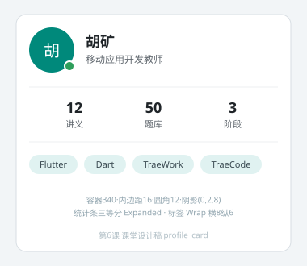

# profile_card 设计稿（第6课课堂发放）

还原目标：340 宽名片卡片，居中于页面。按下列区块自上而下实现，用 Inspector 核对主要间距误差 ±4px 内、无 RenderFlex 溢出告警。

标注说明：

| 区块 | 规格 |
| --- | --- |
| 卡片容器 | 宽340，内边距16，圆角12，白底，阴影 blur 8 offset(0,2) |
| 头像区 | 圆形 56×56（teal 底、白色"胡"字20号），右下 12×12 绿色在线点（Stack+Positioned） |
| 姓名行 | 头像右侧间距12：姓名 18 加粗＋灰色副标题，用 Expanded 防溢出 |
| 统计条 | 三等分（Expanded）：数字 18 加粗、下方灰色标签（讲义12/题库50/阶段3） |
| 标签云 | Wrap，横向间距8、纵向6：Flutter、Dart、TraeWork、TraeCode 四枚 Chip |
| 配色 | teal 种子主色；正文近黑、辅助 black54 |

检查点：与设计稿一致；口头解释统计条为何用 Expanded；层叠角标用 Stack＋Positioned 实现。
